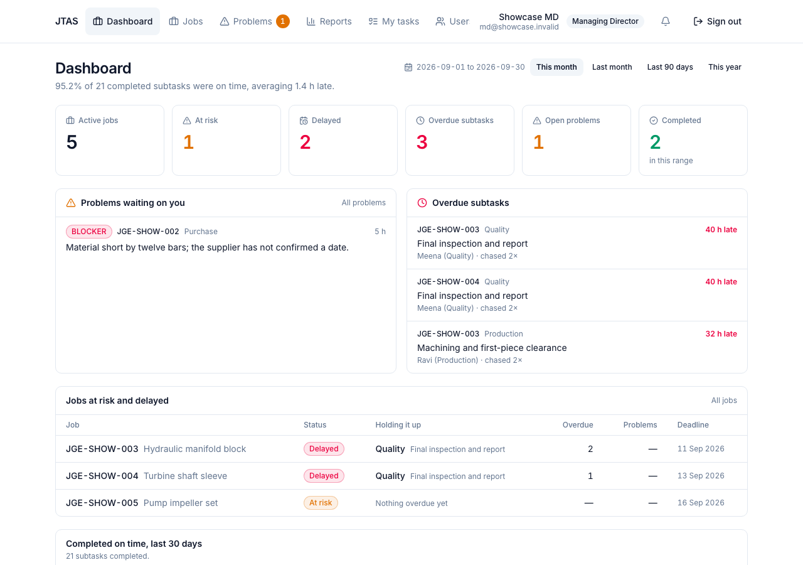
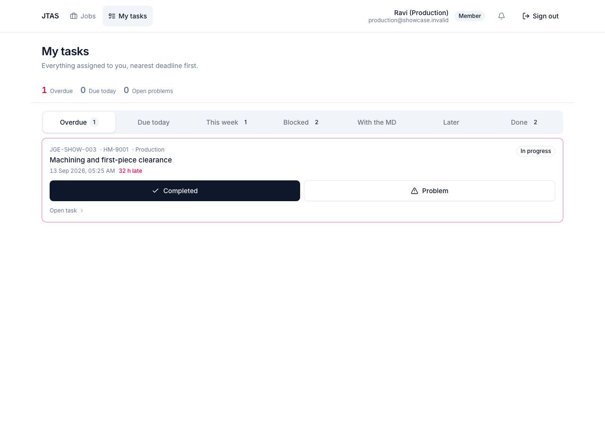

<div align="center">

# JTAS

### Jaraa Task & Accountability System

**Assign it once. The system does the following up.**

`Next.js 15` · `React 19` · `TypeScript` · `PostgreSQL` · `Prisma` · `Zoho Catalyst`

</div>

---

JTAS is the internal job and accountability system for **Jaraa Global Engineering**, a CNC
machining shop in Coimbatore. The MD issues an order, splits it across departments, and the
software does the chasing — every deadline, reminder, escalation and decision on one
written record.

It is built for a shop floor, not a desk: one screen for members, a tap to complete,
English / Tamil / Hindi, and a notification when something is actually due.

Five roles keep the surface small: **MD** (everything), **Deputy MD** (acts for him, each
action stamped "on behalf of MD"), **Admin** (people and settings, read-only on work),
**Member** (their own tasks, problems and extensions), **Supervisor** (the production book
only).

## The loop

1. **Plan.** The MD creates a job — customer, part, drawing, quantity, customer date — by
   hand or from the standard CNC template, which lays out the department chain.
2. **Commit.** Each department gets its turn, then 24 hours to commit a finish date. A date
   nobody committed is not treated as one.
3. **Chase.** Reminders go out before a deadline, escalations after it. Repeat, with a hard
   stop. Problem reported? The pressure moves to the MD.
4. **Decide.** The MD's problem inbox: acknowledge, give more time, reassign, escalate or
   cancel — with a reason that lands in the audit log.
5. **Prove.** Every status change, deadline move and decision is recorded. On-time
   percentage, department scorecards and job reports come out of the same data.

```
Planning → Purchase → Store → Production → Quality → Dispatch → Accounts
                HR (parallel)                    ↑ live map, not a fixed line
```

<p align="center">
  
  
</p>
<p align="center"><sub>Showcase data — the MD dashboard and a member's My tasks.</sub></p>

## What makes it useful

- **One live map per job.** Actual dependencies, current departments, waiting stages and
  open problems — not a status field somebody forgot to update.
- **Chasing that survives restarts.** Every notification is a row with a dedupe key; the
  sweeper claims work with `SKIP LOCKED`. A restart cannot double-send, and a dead
  scheduler turns `/api/health` red instead of going quiet.
- **Accountability with a paper trail.** No hard deletes on work or people; the audit log is
  written in the same transaction as the change.
- **A shop-floor UI.** Phone-first, tap-to-complete, a shift book for supervisors, and push
  notifications that name the event without leaking customer or drawing details.
- **Mail that behaves.** Working-hours aware, allowlist and daily-cap guarded, and never
  mailing demo data.

## Where it runs

|                 |                                                                                 |
| --------------- | ------------------------------------------------------------------------------- |
| **Live**        | <https://jaraa-live-50047542089.catalystappsail.in>                             |
| **Application** | Zoho Catalyst AppSail, custom runtime, 512 MB (`node scripts/start-server.mjs`) |
| **Data**        | PostgreSQL on Neon, pooled over SSL                                             |
| **Attachments** | Zoho Stratus, presigned upload/download                                         |
| **Mail**        | Brevo API in production; SMTP + Mailpit locally                                 |
| **Scheduler**   | Catalyst Job Function `jaraa_scheduler` (same code as the local worker)         |
| **Errors**      | Sentry, when a DSN is configured                                                |

Until November 2026 this ran on one EC2 instance with `docker-compose.prod.yml` (Caddy,
Postgres, Redis, MinIO, nightly S3 backups). That path still works and is documented in
[`docs/DEPLOY.md`](docs/DEPLOY.md) and [`docs/RUNBOOK.md`](docs/RUNBOOK.md).

## Run it locally

Node ≥ 20.11, pnpm 11 and Docker.

```bash
pnpm install
cp .env.example .env          # then set JWT_SECRET and REFRESH_SECRET
pnpm docker:up                # Postgres, Redis, Mailpit, MinIO
pnpm db:migrate && pnpm seed  # prints one temporary password per account, once
pnpm dev                      # http://localhost:3000
pnpm worker                   # the scheduler, in a second terminal
```

Mailpit catches every mail at **localhost:8025**; MinIO's console is at **localhost:9001**.
The seed creates the MD, an admin and one member per department — there is no shared
password, only bcrypt hashes, so a lost one is reset, never recovered.

## Commands

|                                                    |                                                                            |
| -------------------------------------------------- | -------------------------------------------------------------------------- |
| `pnpm dev` · `pnpm worker`                         | App and scheduler, each with a preflight check                             |
| `pnpm build` · `pnpm start`                        | Production build and serve (`start` is not for standalone builds)          |
| `pnpm typecheck` · `pnpm lint` · `pnpm format`     | TypeScript (app + worker), ESLint, Prettier                                |
| `pnpm test` · `pnpm test:unit` · `pnpm e2e`        | Vitest (unit + integration), Playwright                                    |
| `pnpm ship "message"`                              | Typecheck, lint and test — commits only if all three pass                  |
| `pnpm db:migrate` · `pnpm db:deploy`               | Dev migration, production migration                                        |
| `pnpm db:reset`                                    | Guarded: only `localhost`/`127.0.0.1`/`db`, only a `_dev`/`_test` database |
| `pnpm seed` · `pnpm seed:demo` · `pnpm purge:demo` | Reference data, flagged demo history, cleanup                              |

## Non-negotiables

1. **UTC stored, IST shown.** Every timestamp is UTC; display and business hours go through
   `Asia/Kolkata`. Deadlines are built with `fromISTInput()`, never a naive local string.
2. **Server-side authorisation.** One `can(user, action, resource)` in `src/lib/auth/policy.ts`
   guards every route. Hiding a button is not access control.
3. **Thin routes, real services.** Business logic lives in `src/lib/services` and
   `src/lib/domain`; route handlers authenticate, validate with Zod and map errors.
4. **One schema per shape.** Zod schemas in `src/lib/validation` are imported by client and
   server alike.
5. **Audit in the transaction.** If the change commits, the audit row commits with it.
6. **No hard deletes.** Deactivate people, cancel work, soft-delete a job or a file.
7. **Errors have a shape.** `{ error: { code, message, details? } }`, always.
8. **Tests ship with the module.** An 85% line/function floor on `domain` and `notifications`.

## Ship

Production is Catalyst AppSail. Releases are manual, deliberate and verified between
environments:

```text
snapshot env → build linux/amd64 image → prisma migrate deploy
             → upload to AppSail → verify on Development
             → promote to Production → check /api/health
```

The previous image is kept as the rollback. Migrations are forward-only — a bad migration
is a database restore, not a rollback. `/api/health` answers **503** when the scheduler
heartbeat is stale, which is the deploy gate and the uptime check in one.

CI (`.github/workflows/ci.yml`) runs migrations, typecheck, lint, format, the whole test
suite and a production build on every push to `main` and every pull request.

## Testing that earns its keep

Integration tests run against real PostgreSQL in a separate `jtas_test` database, and each
worker gets its own schema — so a run passes on a dirty database and on a fresh one. The
isolation test proves it by polluting the database first. Playwright runs serially because
the specs share one seeded shop.

## Docs

|                                                                       |                                                         |
| --------------------------------------------------------------------- | ------------------------------------------------------- |
| [**PDD**](docs/JARAA_PDD_Product_Design_Document.md)                  | What the product is, and the contract with the MD       |
| [**SDD**](docs/JARAA_SDD_Software_Design_Document.md)                 | Schema, API, business rules, notification engine        |
| [**DEFERRED**](docs/DEFERRED.md)                                      | Every conscious omission and what it would cost         |
| [**RUNBOOK**](docs/RUNBOOK.md)                                        | Self-hosted operations: deploy, restore, triage         |
| [**GO-LIVE**](docs/GO_LIVE_CHECKLIST.md)                              | Launch checks — mail deliverability is the blocking one |
| [**MEMBER**](docs/MEMBER_GUIDE.md) / [**ADMIN**](docs/ADMIN_GUIDE.md) | Guides actually handed to the shop                      |

## Shape of the repo

```text
src/app/          routes and /api handlers        src/lib/services/   use cases + transactions
src/components/   shadcn/ui and shared UI         src/lib/notifications/  channels, sweeper, guards
src/lib/domain/   pure rules and maths            worker/            continuous + Catalyst scheduler
prisma/           schema, migrations, seed        tests/             unit · integration · e2e
```

`.env`, `.deploy/`, seed credential files and Android signing material are git-ignored.
No live credential lives in this repository. `.env.example` documents every variable.
